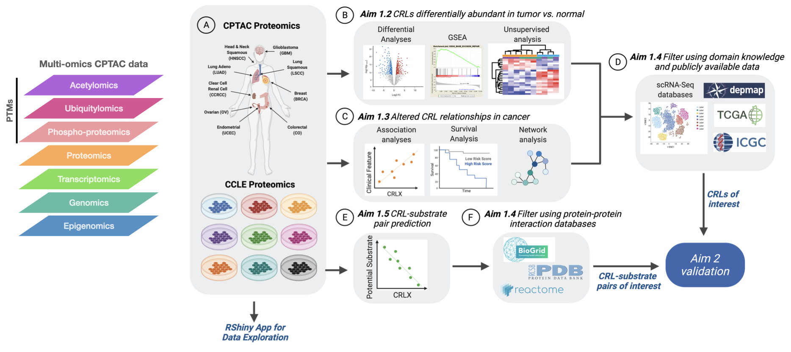

# UbiDash

Interactive dashboard to query multi-omic datasets from human tissues and/or cell lines, with special focus on E3 ubiquitin ligases of the Cullin RING Ligase (CRL) family.

## Overview

UbiDash is a web interface allowing the user to query and generate interactive plots based on the **CPTAC, CCLE, PRIDE, and TPCPA** datasets. UbiDash is implemented using the R programming language (v4.4.1 https://www.r-project.org/) and the Shiny package (v1.8.1.1 https://shiny.posit.co/). UbiDash is hosted by shinyapps.io (https://shinyapps.io) and is available at https://ruggleslab.shinyapps.io/UbiDash/.

The **Mutational Effects** section of the app allows the user to generate oncoplots and lollipop plots based on the CPTAC Pancan Mutations and filter this dataset based on user selected parameters. The mutations section of the app additionally allows the user to create volcano and boxplots representing quantitative trait locus analysis comparing UPS and mutant genes in the CPTAC Pancan Dataset of their selection.

The **UPS Protein Profiles** and **Differential Expression** sections of the app allow the user to generate heatmaps based on data from the **CPTAC, CCLE, PRIDE, and TPCPA** datasets with customizable parameters including row and column clustering, the use of row z-scores, and user selected cohorts and cancer subtypes. The user may additionally create a summarized profile heatmap based on the harmonized datasets. The user may also use these sections to create volcano plots based on different cohorts in the CPTAC dataset and density plots based on specific **protein** genes in the CPTAC dataset.

In the **Clinical Potential** section of the app, the user may create boxplots displaying **protein** expression in the CPTAC dataset. The user may also view drug response information for a selected gene from both TCGA and CCLE.

In the **Protein Associations** tab, the user may create, and plot based on correlation analysis of the CPTAC dataset which can be filtered by cohorts of the user's preference. The datasets and analyzed outputs may be downloaded by the user (See Key Resources Table for all packages used on UbiDash development).

***
